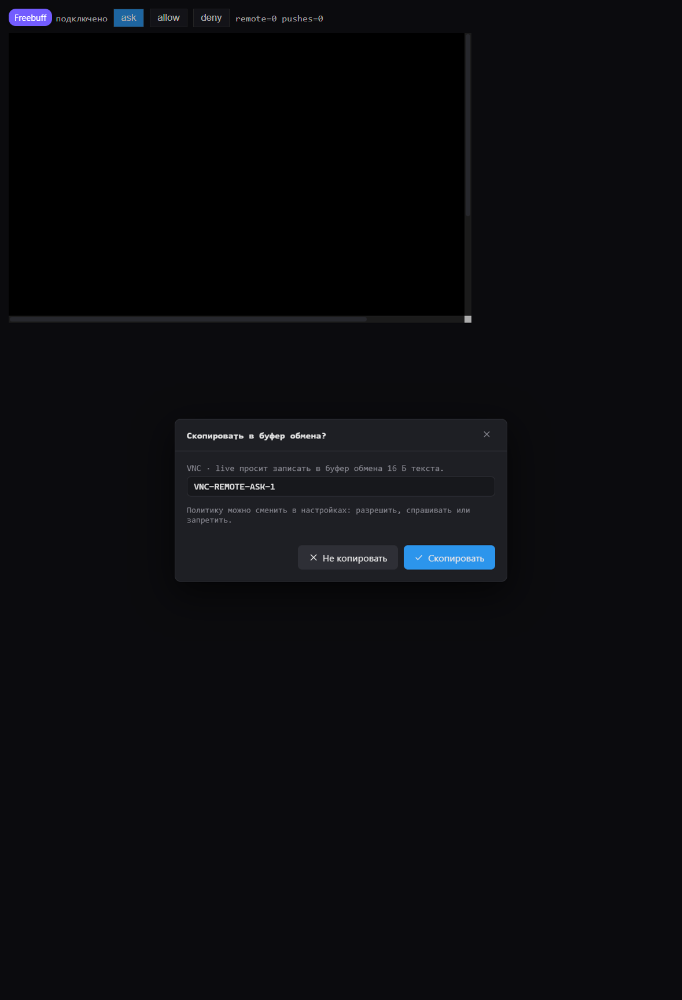
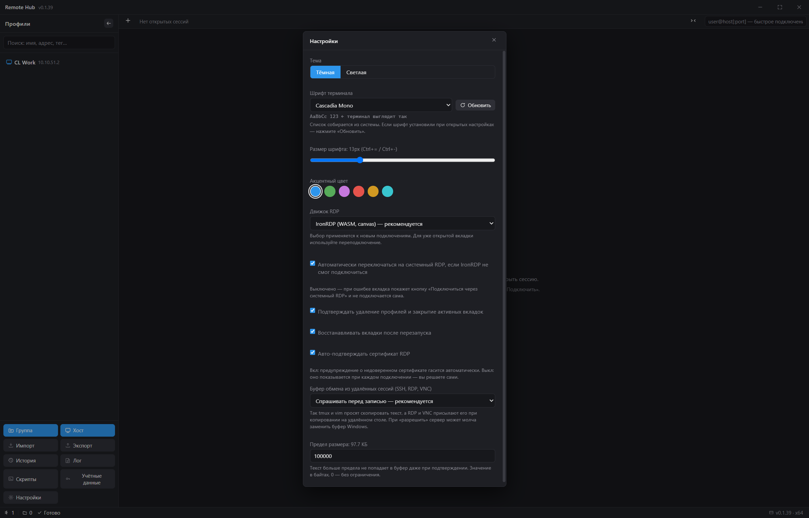

# Живые проверки политики буфера

Автотесты лежат в `tests/clipboard-policy.test.ts` и `tests/clipboard-sync.test.ts`;
здесь — то, что видно только в запущенном приложении.

## VNC: ask / deny / allow и эхо (2026-11-17)

Стенд: `debian:bookworm-slim` с `Xvfb` + `x11vnc` 0.9.16, клиент — настоящий noVNC
1.7, но с настоящей логикой приложения (`createClipboardSync`, `offerRemoteClipboard`,
`ClipboardAskDialog`, стор настроек); подменён только `window.api` — вместо IPC
Electron локальный сервер писал и читал реальный буфер Windows.

- `ask`: текст `VNC-REMOTE-ASK-1` с удалённой стороны → диалог с источником
  «VNC · live», размером 16 Б и предпросмотром; буфер Windows остался прежним.
- `allow`: событие пришло в 089735 мс, запись в буфер — в 090061 мс (326 мс),
  диалога нет.
- `deny`: событие пришло, буфер не изменился, записей — 0.
- Эхо: после принятого текста 21 тик опроса (15 с) не дал ни одного обратного push
  и ни одного нового события.
- Найдено и исправлено (коммит `ec4748b`): при `ask`/`deny` опрос отправлял на
  сервер прежний локальный буфер, сервер возвращал его эхом, и подтверждение
  подменялось нашим же текстом.

## Собранное приложение 0.1.39 (2026-11-17)

`release\win-unpacked\Remote Hub.exe` из локальной сборки (`install-app-deps` →
`electron-vite build` → `electron-builder --win --x64 --publish never`).

- Окно отрисовалось: «Remote Hub», v0.1.39, дерево профилей, статус «Готово ·
  v0.1.39 · x64». Подключение к окну — по CDP (`--remote-debugging-port`).
- Настройки → «Буфер обмена из удалённых сессий (SSH, RDP, VNC)»: селект в
  положении `ask` («Спрашивать перед записью — рекомендуется») со всеми тремя
  вариантами, «Предел размера: 97.7 КБ», поле `100000`, обе подсказки на месте.
- Ошибок нет: консоль страницы (`Runtime` + `Log`) — ни ошибок, ни исключений,
  ни предупреждений; stdout — только проверка обновлений («Update for version
  0.1.39 is not available»).

Не проверялось: установка NSIS-инсталлятором (ярлыки, каталог, удаление), живой
сценарий `ClipboardAskDialog` в собранном приложении, смена и сохранение настроек
через UI, подпись сборки (сертификата в окружении нет).
